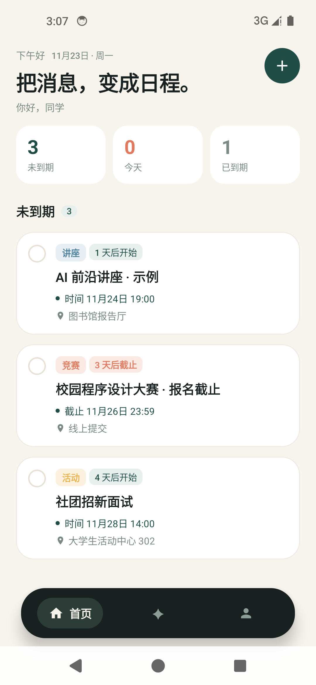
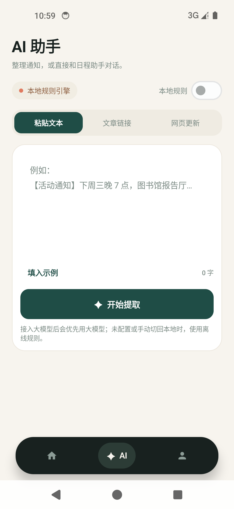
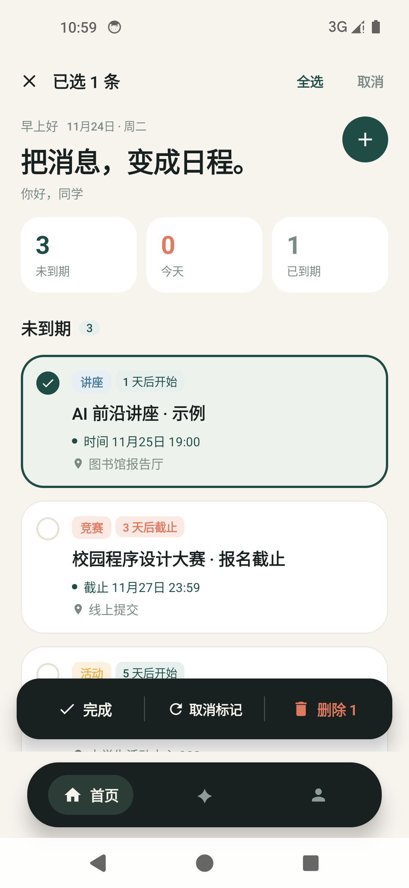
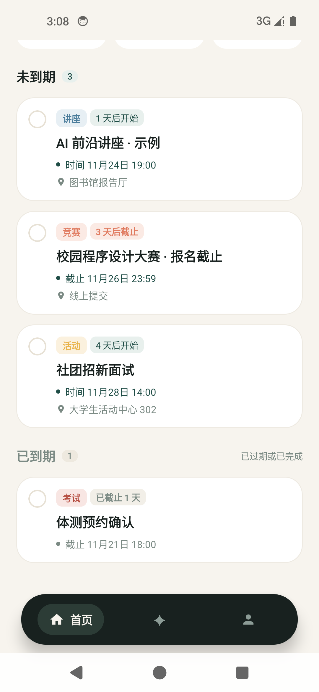

# 校程 · xiaocheng-Tool

一个轻量的校园信息聚合与 AI 日程助手。

把班级群、社团群、公众号文章和学校公告里的通知丢进来，校程会抽出事件、开始时间、截止时间、地点和链接，整理成「未到期 / 已到期」看板，并可以导出带提醒的日历。

> 中文名：校程；英文名：xiaocheng。

- 安装包约 1.3 MB，无广告、无后台常驻
- 权限只有网络，数据保存在本机
- 支持 Android 8.0（API 26）及以上
- 安装包命名：xiaocheng-v版本号.apk；GitHub Release 标题：v版本号

当前版本：1.2.1（versionCode 10201），版本规则见 [VERSIONING.md](VERSIONING.md)。

## 界面

| 首页 | AI 助手 |
|---|---|
|  |  |

| 多选 | 已到期 |
|---|---|
|  |  |

## 功能

- 首页看板：按「未到期 / 已到期」分组，顶部显示未到期、今天、已到期数量。
- 顺序更直观：每条日程按距离截止/开始的远近排序；同一时刻时截止任务优先于开始任务。
- 开始 / 截止分开：每条日程分别显示「N 天后开始」和「N 天后截止」，两个标签按真实时间排序，截止早于开始时截止排在前面。
- 已截止但未开始的活动留在「未到期」，避免被提前归档。
- 长按多选：支持全选、批量标记完成、批量取消完成标记、批量删除；删除前二次确认。
- 三页切换：只通过底部导航切换，保留平滑动画，不再支持左右滑页。
- AI 双模式：
  - 经典模式：粘贴群消息、通知文本、单篇公开文章链接，或检查通知页更新；
  - 综合模式：对话式日程助手，可以问安排、新增/修改/完成/删除日程，也可以把网页链接发给他读；
  - 综合版内置日程助手人设，会拒绝与日程无关的题目；修改日程前可选择自动执行或先确认。
- 引擎默认本地：接入 API 后，AI 页顶部开关默认关闭；打开才走大模型，可随时切回本地。
- 开关只在经典版显示；综合版隐藏，切回经典需要到「功能设置」里改模式。
- 功能设置：AI 模式、API 额度查询、测试连接；综合版才显示联网、自动执行、常驻要求。
- 检查更新：从 GitHub Release 检查新版本；支持一键下载安装，也保留下载页入口。
- 时间与联网：会从网络时间校准日期；综合版可联网搜索公开网页。
- 设置精简：功能设置只显示当前模式需要的选项，经典版不再出现综合版设置。
- 联网与时间：综合版会读取当前时间；开启联网后，涉及实时信息的问题会先搜索公开网页。
- 登录页兜底：可以在浏览器登录后复制正文，粘贴到「登录后正文」让 AI 直接整理。
- 界面精简：移除关于页、无用分组和重复按钮，设置文案更短。
- 结果清理：抽取结果支持「全部保存」或「一键清除」，清除会同时清空输入内容。
- 网页更新：接入 AI 后先读页面正文和链接再整理；内容不足时尝试在线阅读器兜底，并给出明确提示。
- 结构化字段：事件名称、开始时间、截止时间、地点、链接、分类（竞赛/讲座/活动/就业/志愿/考试/其他）、说明。
- 可选大模型：配置任意 OpenAI 兼容接口（默认 DeepSeek）后使用大模型抽取；没有 Key 或调用失败时自动回退到离线规则。
- 日历导出：生成标准 .ics，带提前 30 分钟提醒，可通过系统文件选择器保存后用手机日历导入。
- 本地优先：日程、API Key、通知页快照都保存在手机本机，不上传服务器。

## 安装

正式包：

[dist/xiaocheng-v1.2.1.apk](dist/xiaocheng-v1.2.1.apk)

直接下载安装，需允许「安装未知来源应用」。Android 8.0 及以上。

## 使用

1. 打开 App，首页默认有 3 条示例日程，可以在「个人 → 数据管理」清空。
2. 进入「AI 助手」页：
   - 想快速体验：点「填入示例」，再点「开始提取」；
   - 想用自己的通知：把群消息粘贴到输入框；
   - 想解析文章：切到「文章链接」，粘贴公开链接；
   - 想检查公告页：切到「网页更新」，填公开通知页链接，点「AI 整理并检查」。
3. 抽取结果可以逐条保存，也可以「全部保存到日程」。
4. 首页点卡片可编辑时间、地点、分类和备注；左侧圆圈可标记完成；长按可多选。
5. 「个人 → 导出 .ics 日历」保存日历文件，用手机日历打开即可导入。

### 配置大模型（可选）

「个人 → AI 配置」：

- 接口地址：https://api.deepseek.com/v1（或任意 OpenAI 兼容地址）
- 模型名称：deepseek-chat
- API Key：你自己的 Key

Key 只保存在本机。未配置时使用离线规则，常见中文时间表达同样可以识别。

### 切换 AI 模式

AI 页默认根据「个人 → 功能设置」里的选择显示经典或综合模式。
未配置 API 时只能使用经典模式；配置 API 后可以在功能设置里切换综合版。
AI 页顶部的开关只负责「大模型 / 本地规则」，默认是本地规则，打开才走大模型；这个开关只在经典版显示。

功能设置会按当前模式分开显示：综合版才出现联网、自动执行、常驻要求等设置；经典版只显示经典版说明和通用 API 设置。

## 实现

- 语言：Kotlin
- UI：Jetpack Compose + Material 3，三页 HorizontalPager 左右滑动
- 网络：OkHttp
- 网页解析：Jsoup
- 数据：SharedPreferences + JSON
- 日历：手写 iCalendar（RFC 5545），不依赖第三方库
- AI：OpenAI 兼容 Chat Completions；提示词要求输出严格 JSON，解析失败自动回退本地规则

### 抽取结构

    {
      "events": [
        {
          "title": "人工智能前沿讲座",
          "start_time": "2026-12-02 19:00",
          "deadline": "2026-11-27 18:00",
          "location": "图书馆报告厅",
          "link": "https://example.com/ai-lecture",
          "category": "讲座",
          "description": "报名截止本周五"
        }
      ]
    }

### 时间处理

- 只有日期时：活动开始默认 09:00，截止默认 23:59。
- 没有年份时使用当前年份；日期过去超过约 200 天时理解为下一年。
- 「明天（12月28日）」这种写法优先采用括号里的绝对日期。
- 截止相关词：截止、截至、DDL、之前。

## 自己编译

环境：JDK 17、Android SDK Platform 34、Build Tools 34.0.0、Gradle 8.7。

在 local.properties 里写 SDK 路径（参考 local.properties.example）：

    sdk.dir=C:\Users\你的用户名\AppData\Local\Android\Sdk

构建：

    gradlew.bat assembleRelease

输出：

    app/build/outputs/apk/release/app-release.apk

签名文件不随仓库提交；如果 signing/keystore.properties 不存在，release 包不签名，方便直接编译调试。

## 目录结构

    app/src/main/java/com/xiaocheng/app/
    ├─ MainActivity.kt       入口
    ├─ MainViewModel.kt      状态、抽取、网页更新、保存
    ├─ data/                 事件模型、SharedPreferences、仓库
    ├─ ai/                   本地规则、OpenAI 兼容客户端、统一抽取服务
    ├─ net/                  网页正文 / 通知条目抓取
    ├─ export/               iCalendar 导出
    └─ ui/                   主题、三页导航、首页、AI、个人、编辑弹窗
    dist/                    发布用 APK
    screenshots/             界面截图

## 版本规则

采用 MAJOR.MINOR.PATCH，versionCode = MAJOR × 10000 + MINOR × 100 + PATCH。

- 1.0.0 = 10000
- 1.0.1 = 10001
- 1.1.0 = 10100

安装包、Git tag、Release 标题的版本号保持一致。详见 [VERSIONING.md](VERSIONING.md)，每个版本的改动见 [CHANGELOG.md](CHANGELOG.md)。

## 隐私与边界

- 只处理用户主动提交的文本或公开链接，不读取微信本地数据库，不 Hook 微信。
- 不模拟登录学习通、教务系统或公众号后台。
- 不批量爬取公众号文章列表，只解析用户提交的单篇公开链接。
- 不做 7×24 后台定时监控，网页更新由用户手动触发。
- 不申请通讯录、定位、后台常驻等权限。

## 已知限制

- 纯前端动态渲染的通知页可能识别不到条目。
- 模糊时间（本月底、国庆后）支持有限，需要更复杂的语义处理。
- 手机端提醒依赖导出的 .ics 导入系统日历。

## License

[MIT](LICENSE)
